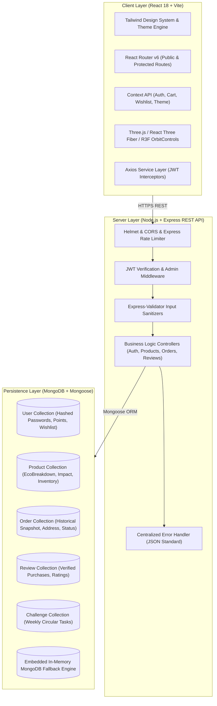

# EcoSphere 🌍
> **Shop better. Impact the planet less.**
> A production-grade MERN e-commerce platform combining circular lifecycle analytics, 0–100 EcoScore scoring, zero-greenwashing transparent metrics, and interactive 3D web experiences.

🌐 Live Demo

"Visit EcoSphere Live Demo" (https://ecosphere-flax.vercel.app)

«Explore the live sustainable e-commerce platform, including eco-friendly products, EcoScore, sustainability insights, cart, and more.»

[](https://reactjs.org/)
[](https://threejs.org/)
[](https://tailwindcss.com/)
[](https://opensource.org/licenses/MIT)

---

## 📑 Table of Contents
1. [Overview & Problem Statement](#-overview--problem-statement)
2. [The EcoSphere Solution](#-the-ecosphere-solution)
3. [Architecture Diagram](#-architecture-diagram)
4. [Tech Stack](#-tech-stack)
5. [Project Structure](#-project-structure)
6. [Core Features & Brief Compliance](#-core-features--brief-compliance)
   - [Tier 1: Compulsory Requirements](#tier-1-compulsory-requirements-all-verified)
   - [Tier 2: Bonus Challenges](#tier-2-bonus-challenges-all-8-implemented)
   - [Tier 3: EcoSphere Differentiators](#tier-3-ecosphere-differentiators-the-unique-concept)
   - [Tier 4: 3D Experience & Polish](#tier-4-3d-experience--polish)
7. [EcoScore (0–100) Methodology](#-ecoscore-0100-methodology)
8. [API Reference Table](#-api-reference-table)
9. [Local Setup & Getting Started](#-local-setup--getting-started)
10. [Demo Credentials & Quick Judge Access](#-demo-credentials--quick-judge-access)
11. [2-Minute Hackathon Demo Script](#-2-minute-hackathon-demo-script)
12. [Deployment Guide](#-deployment-guide)
13. [Honesty & Compliance Disclaimer](#-honesty--compliance-disclaimer)
14. [Brief Compliance Verification Report](#-brief-compliance-verification-report)

---

## 🌿 Overview & Problem Statement

### The Problem
Conventional e-commerce incentivizes ultra-fast, disposable consumption:
- Over **91% of consumer plastics** end up in landfills or marine ecosystems.
- Products are routinely advertised as "eco-friendly" or "green" without reproducible criteria or empirical metrics (**Greenwashing**).
- Orders arrive double-wrapped in disposable virgin polyethylene film and single-use bubble wrap.
- Shoppers have no transparency into the lifetime durability, repairability, or circular end-of-life options for the items they purchase.

---

## 💡 The EcoSphere Solution

EcoSphere reimagines circular commerce from the ground up:
- **Transparent 0–100 EcoScore**: Every product is algorithmically evaluated across 5 tangible lifecycle dimensions (Material 25%, Reusability 25%, Packaging 20%, Durability 15%, Recyclability 15%).
- **Quantified Plastic Avoidance**: Real-time tracking of estimated kilograms of single-use plastic diverted and lifetime CO₂ footprint avoided.
- **Side-by-Side Alternatives**: Objective comparisons demonstrating exactly how reusable items outperform single-use disposable counterparts.
- **Interactive 3D Immersion**: Procedural Three.js Earth globes and rotating 3D product viewers with graceful 2D fallbacks and reduced-motion support.
- **Zero Greenwashing Policy**: All environmental numbers are honestly identified as comparative estimates, backed by full formula disclosures.

---

## 🏛 Architecture Diagram



---

## 🛠 Tech Stack

| Layer | Technologies |
|---|---|
| **Frontend** | React 18 (Functional components + Hooks), Vite, React Router v6, Tailwind CSS v3, Axios, Lucide React, Framer Motion |
| **3D & Canvas** | Three.js, `@react-three/fiber`, `@react-three/drei`, Canvas Confetti, WebGL capability detection |
| **Backend** | Node.js, Express.js REST API, JSON Web Tokens (JWT), bcryptjs password hashing |
| **Security & Quality** | Helmet security headers, CORS origin filtering, Express Rate Limiting, Express-Validator |
| **Database** | MongoDB, Mongoose ODM, with automatic `mongodb-memory-server` fallback for zero-configuration testing |
| **Testing** | Jest, Supertest (backend integration suite), Puppeteer (end-to-end headless browser verification) |

---

## 📂 Project Structure

```text
EcoSphere/
├── client/                     # Vite + React 18 Frontend
│   ├── src/
│   │   ├── assets/             # Brand logos & static assets
│   │   ├── components/         # Reusable UI & specialized components
│   │   │   ├── common/         # Button, Input, Skeleton, EmptyState, ErrorState
│   │   │   ├── Navbar.jsx      # Responsive header with search, cart badge, auth
│   │   │   ├── Footer.jsx      # Brand links, principles, methodology links
│   │   │   ├── ProductCard.jsx # Reusable product card with EcoScore badge & quick add
│   │   │   ├── CartItem.jsx    # Cart row with +/- quantity controls & impact note
│   │   │   ├── OrderSummary.jsx# Reusable calculation card with dynamic impact badge
│   │   │   ├── EcoImpactCard.jsx# 5-factor breakdown & honest disclaimer
│   │   │   ├── Product3DViewer.jsx# 3D drag-to-rotate viewer with WebGL fallback
│   │   │   ├── Hero3DCanvas.jsx# Procedural interactive 3D Earth globe
│   │   │   ├── EcoAssistant.jsx# Rule-based zero-waste chatbot drawer
│   │   │   ├── ErrorBoundary.jsx# Isolated UI crash boundary
│   │   │   └── ProtectedRoute.jsx# Auth and Admin route protection guards
│   │   ├── context/            # Global React Context state providers
│   │   │   ├── AuthContext.jsx # User profile, JWT persistence, EcoJourney tier
│   │   │   ├── CartContext.jsx # Cart items, quantity modifiers, impact counters
│   │   │   ├── WishlistContext.jsx # Saved items, backend synchronization
│   │   │   └── ThemeContext.jsx# Dark/light theme state with CSS variables
│   │   ├── pages/              # Main route views
│   │   │   ├── Home.jsx        # Landing page with 3D Hero, Picks, Categories
│   │   │   ├── Products.jsx    # Catalog with search, 80+ EcoScore, sort, pagination
│   │   │   ├── ProductDetail.jsx# Product detail, 3D view, alternative comparison
│   │   │   ├── Login.jsx       # Login/Register with 1-click Demo buttons
│   │   │   ├── Cart.jsx        # Shopping cart view with dynamic totals
│   │   │   ├── Checkout.jsx    # Form validation & sandbox payment selectors
│   │   │   ├── Orders.jsx      # Past orders listing
│   │   │   ├── OrderDetail.jsx # Visual status tracker stepper & address receipt
│   │   │   ├── Account.jsx     # User profile & circular metrics summary
│   │   │   ├── Wishlist.jsx    # Wishlist management and move-to-cart
│   │   │   ├── Impact.jsx      # Personal impact ledger & weekly eco challenges
│   │   │   ├── HowEcoScoreWorks.jsx# Methodology disclosure & interactive calculator
│   │   │   ├── Compare.jsx     # Side-by-side product comparison (up to 3 items)
│   │   │   ├── Pitch.jsx       # Hackathon judge presentation pitch
│   │   │   └── NotFound.jsx    # 404 handler
│   │   ├── services/
│   │   │   └── api.js          # Centralized Axios service with JWT interceptor
│   │   ├── index.css           # Tailwind directives & CSS design tokens
│   │   └── main.jsx            # Application entry point
│   ├── .env.example
│   ├── package.json
│   ├── tailwind.config.js
│   └── vite.config.js
├── server/                     # Node + Express REST API
│   ├── controllers/            # Controller business logic
│   │   ├── authController.js   # Register, Login, Me, DemoLogin
│   │   ├── productController.js# Query, Search, Filter, Admin CRUD, Picks, Alts
│   │   ├── orderController.js  # Order validation, stock atomic decrement, status
│   │   ├── wishlistController.js# Add, remove, list saved items
│   │   ├── reviewController.js # Verified reviews & average rating recalculation
│   │   └── challengeController.js# Weekly eco challenges & point rewards
│   ├── middleware/             # Express middlewares
│   │   ├── authMiddleware.js   # JWT Bearer token protection
│   │   ├── adminMiddleware.js  # Admin role verification
│   │   ├── validate.js         # Express-validator wrapper
│   │   └── errorHandler.js     # Centralized JSON error response handler
│   ├── models/                 # Mongoose Data Schemas
│   │   ├── User.js             # User accounts, hashed passwords, eco points
│   │   ├── Product.js          # Products, EcoScore breakdown, stock, alternative
│   │   ├── Order.js            # Orders, frozen purchase prices, impact snapshot
│   │   ├── Review.js           # Reviews, ratings, verified purchase flags
│   │   └── Challenge.js        # Sustainable community challenges
│   ├── routes/                 # Express route definitions
│   ├── seed/
│   │   └── seedData.js         # 28 realistic products, demo user, demo admin
│   ├── tests/
│   │   ├── api.test.js         # Jest + Supertest integration tests
│   │   └── browserVerify.js    # Puppeteer end-to-end browser verification script
│   ├── .env.example
│   ├── package.json
│   └── server.js               # Express application entry & DB connection
├── TODO.md                     # Brief Compliance Checklist & Progress Tracker
├── README.md                   # Complete system documentation
└── .gitignore
```

---

## 🎯 Core Features & Brief Compliance

### Tier 1: Compulsory Requirements (All Verified)
- **Home & Navigation**: Responsive navbar with mobile drawer, brand logo, search bar, cart badge, wishlist counter, and theme toggle.
- **Dynamic Products**: All products fetched via REST API from MongoDB (never hardcoded); includes categories, pricing, stock, ratings, and image galleries.
- **Dynamic Product Details**: Route `/product/:id` dynamically loaded from data.
- **Search & Filters**: Multi-factor filtering by text query, category, and minimum EcoScore.
- **Authentication**: User registration and login with bcryptjs password hashing (passwords never returned in JSON) and JWT-based authentication.
- **Protected Routes**: ProtectedRoute guards on frontend; JWT auth middleware on backend (`GET /api/auth/me`).
- **Cart System**: Add to cart, adjust quantities (+/-), remove items, dynamic subtotals, free shipping threshold (₹999), and empty cart states.
- **Checkout & Orders**: Complete shipping address validation, itemized summary, atomic stock deduction, and persistent storage in MongoDB.
- **Orders History**: Customers can view past orders (`/orders`) and detailed order tracking (`/orders/:id`). Strict ownership authorization prevents User A from accessing User B's orders.
- **Architecture**: 100% React functional components, reusable design components, Context API state, Axios service layer, and environment variable configuration.

### Tier 2: Bonus Challenges (All 8 Implemented)
1. **Admin Dashboard (`/admin`)**: Role-based access for admins to create products, edit details, update stock, delete items, and change customer order statuses.
2. **Image Uploads**: Product image URL field with Cloudinary / image host support and automatic graceful fallback.
3. **Payment Gateways**: Cash on Delivery (COD) active by default; Card and UPI sandbox test modes explicitly labeled as demo transactions (never faking payment success).
4. **Wishlist**: Full wishlist API (`GET /api/wishlist`, `POST/DELETE /api/wishlist/:productId`) with a "Move to Cart" action.
5. **Product Reviews**: Logged-in users submit ratings (1–5 stars) and comments. Automatically updates product average rating and count.
6. **Advanced Filtering**: Debounced search, URL sync with `useSearchParams`, multi-factor sorting (newest, price asc/desc, top rated, highest EcoScore), and pagination.
7. **Order Status Stepper**: Visual 4-step progress tracker (`Processing` → `Confirmed` → `Shipped` → `Delivered`) reflecting admin updates in real time.
8. **Enhanced UI**: Skeletons for loading states, toast notifications via `react-hot-toast`, polished empty states, and isolated `ErrorBoundary`.

### Tier 3: EcoSphere Differentiators (The Unique Concept)
- **Eco Impact Card**: Displayed on all product cards and product detail views; highlights material integrity, reusability, packaging, estimated plastic avoided*, and carbon footprint savings*.
- **EcoScore Index (0–100)**: Internal comparative rating calculated from:
  $$\text{EcoScore} = \text{Material (25)} + \text{Reusability (25)} + \text{Packaging (20)} + \text{Durability (15)} + \text{Recyclability (15)}$$
- **Disclose Methodology (`/how-ecoscore-works`)**: Comprehensive breakdown with transparent criteria and an interactive score simulator.
- **Disposable vs. Sustainable Comparison**: Direct side-by-side card comparing each product against its single-use plastic equivalent.
- **My Impact Dashboard (`/impact`)**: Cumulative plastic avoided, carbon diverted, orders placed, and Eco Journey progression.
- **Eco Journey Tiers**: Progression from **Seed** (0–99 pts) → **Sprout** (100–299 pts) → **Grower** (300–599 pts) → **Earth Keeper** (600+ pts).
- **Weekly Eco Challenges**: Community zero-waste challenges awarding EcoPoints upon completion.
- **Compare Mode (`/compare`)**: Side-by-side comparison table of up to 3 products simultaneously.
- **Keep It in the Loop**: Cards for Resell, Community Donate, and Zero-Waste Takeback honestly labeled as "Coming Soon".
- **Judge Demo Mode & Pitch Page (`/pitch`)**: One-click demo buttons for Customer and Admin accounts, plus a dedicated pitch deck page.
- **EcoSphere Assistant**: Rule-based chatbot drawer providing factual zero-waste lifestyle guidance.

### Tier 4: 3D Experience & Polish
- **3D Hero Globe**: Interactive Earth-like procedural Three.js sphere with an orbiting ring, subtle mouse parallax, and WebGL capability detection.
- **3D Product Viewer**: "Photo Gallery / 3D Viewer" switch on `/product/:id` featuring procedural geometric models with OrbitControls drag-to-rotate.
- **Eco Tree Visual**: Responsive badge art evolving with the user's Eco Journey tier.
- **Polish & Performance**: Lazy-loaded 3D canvases via `React.lazy` + `Suspense`, capped device pixel ratio (`1.5`), `prefers-reduced-motion` compliance, and dark/light mode toggle.

---

## 📊 EcoScore (0–100) Methodology

| Lifecycle Dimension | Weight | Criteria & Evaluation |
|---|---|---|
| **Material Integrity** | **25%** | GOTS certified organic fibers, 304 food-grade stainless steel, French flax linen, or upcycled materials. Virgin petrochemical plastics score 0. |
| **Daily Reusability** | **25%** | Quantifies how many single-use disposable items are eliminated each year (e.g. replacing 167 plastic water bottles). |
| **Packaging Circularity** | **20%** | 100% plastic-free packaging: FSC-certified unbleached corrugated cardboard, water-activated kraft tape, and natural soy inks. |
| **Durability & Repairability** | **15%** | High-tensile canvas, solid knurled brass, borosilicate glass, or lifetime modular repair parts. |
| **Recyclability & End-of-Life** | **15%** | Mono-material composition, backyard compostable plant fibers, or infinitely recyclable metal alloys. |

---

## 📡 API Reference Table

| Method | Endpoint | Access | Description |
|---|---|---|---|
| `GET` | `/api/health` | Public | System health check and MongoDB connection status |
| `POST` | `/api/auth/register` | Public | Register user, hash password with bcrypt, return JWT |
| `POST` | `/api/auth/login` | Public | Authenticate user credentials, return JWT |
| `GET` | `/api/auth/me` | Private | Retrieve authenticated user profile and stats |
| `POST` | `/api/auth/demo-login` | Public | One-click instant login for Demo Customer or Demo Admin |
| `GET` | `/api/products` | Public | Query products with category, minEcoScore, search, sort, pagination |
| `GET` | `/api/products/picks` | Public | Dynamically compute top-scoring EcoSphere Picks |
| `GET` | `/api/products/:id` | Public | Get single product by ID or slug |
| `GET` | `/api/products/:id/alternatives` | Public | Fetch higher EcoScore alternatives in the same category |
| `POST` | `/api/products` | Admin | Create new product with EcoBreakdown and stock |
| `PUT` | `/api/products/:id` | Admin | Update product details and inventory |
| `DELETE` | `/api/products/:id` | Admin | Remove product from catalog |
| `POST` | `/api/orders` | Private | Place order with server-side price & stock verification |
| `GET` | `/api/orders/myorders` | Private | Get authenticated user's order history |
| `GET` | `/api/orders/:id` | Private | Get order details (strict customer ownership check) |
| `GET` | `/api/orders` | Admin | View all orders across the entire platform |
| `PUT` | `/api/orders/:id/status` | Admin | Update order status (`Processing`, `Confirmed`, `Shipped`, `Delivered`) |
| `GET` | `/api/wishlist` | Private | Get customer's saved wishlist |
| `POST` | `/api/wishlist/:productId` | Private | Add product to wishlist |
| `DELETE` | `/api/wishlist/:productId` | Private | Remove product from wishlist |
| `GET` | `/api/reviews/:productId` | Public | Get verified reviews for a product |
| `POST` | `/api/reviews/:productId` | Private | Submit review (auto-recalculates average rating) |
| `GET` | `/api/challenges` | Public | List active weekly sustainability challenges |
| `POST` | `/api/challenges/:id/complete` | Private | Complete eco challenge and claim EcoPoints |

---

## 🚀 Local Setup & Getting Started

### Prerequisites
- **Node.js** (v18 or higher recommended; v24 verified)
- **npm** (v9 or higher)
- Optional: Local MongoDB or MongoDB Atlas URI (If omitted, the server automatically starts an embedded MongoDB in-memory engine!)

### Step 1: Clone Repository
```bash
git clone https://github.com/your-username/ecosphere.git
cd ecosphere
```

### Step 2: Configure Environment Variables
Copy the `.env.example` templates to `.env`:
```bash
# Server configuration
cp server/.env.example server/.env

# Client configuration
cp client/.env.example client/.env
```

**Server `.env`:**
```ini
PORT=5000
NODE_ENV=development
MONGODB_URI=mongodb://127.0.0.1:27017/ecosphere
JWT_SECRET=ecosphere_super_secret_jwt_key_devcamp2026_secure
JWT_EXPIRES_IN=7d
CLIENT_URL=http://localhost:5173
```
*(If local MongoDB is not running, the server gracefully falls back to `mongodb-memory-server` and seeds automatically with zero manual setup!)*

**Client `.env`:**
```ini
VITE_API_URL=http://localhost:5000/api
```

### Step 3: Install Dependencies
```bash
# In the server directory:
cd server
npm install

# In the client directory:
cd ../client
npm install
```

### Step 4: Run the Application
Open two terminal windows:

**Terminal 1 (Backend Server):**
```bash
cd server
npm start
# Server listens at http://localhost:5000
```

**Terminal 2 (Frontend Client):**
```bash
cd client
npm run dev
# Client runs at http://localhost:5173
```

### Step 5: Run Automated Tests
```bash
# Run backend Jest + Supertest integration tests
cd server
npm test

# Run Puppeteer headless browser verification (requires server & client running)
node tests/browserVerify.js
```

---

## 🔑 Demo Credentials & Quick Judge Access

For hackathon judges and evaluators, the login page features **one-click demo login buttons** requiring zero typing:

| Role | Email | Password | Pre-populated Data |
|---|---|---|---|
| **Demo Customer** | `demo@ecosphere.dev` | `EcoDemo123!` | 2 past orders, 340 EcoPoints, Grower tier, saved wishlist |
| **Demo Admin** | `admin@ecosphere.dev` | `EcoAdmin123!` | Full product CRUD, order status management, 850 EcoPoints |

---

## ⏱ 2-Minute Hackathon Demo Script

1. **Homepage (0:00 - 0:30)**:
   - Land on `http://localhost:5173/`. Observe the interactive 3D Earth globe with orbiting circular elements and subtle mouse parallax.
   - Scroll through the 8 curated categories, dynamically computed EcoSphere Picks, transparent EcoScore overview, and the "Keep It in the Loop" circular section.
2. **Product Details & 3D Viewer (0:30 - 0:50)**:
   - Open any product (e.g., *Insulated Pure Copper & Steel Flask*).
   - Switch from "Photo Gallery" to "3D Interactive Viewer" and drag to rotate the product 360°.
   - Review the 5-factor EcoScore breakdown and the "Sustainable vs. Disposable Alternative" comparison table.
3. **Cart & Checkout (0:50 - 1:15)**:
   - Click "Add to Conscious Cart". Notice the real-time Environmental Contribution Certificate in the Order Summary updating plastic avoided and carbon saved.
   - Click "Proceed to Delivery & Payment". Fill out the delivery form, select Cash on Delivery or Sandbox Card, and place the order.
4. **Order Tracking & Impact Ledger (1:15 - 1:45)**:
   - View the generated order detail page featuring the shipment progress stepper (`Processing` → `Delivered`).
   - Navigate to `/impact` to inspect your evolving Eco Tree, your Eco Journey badge (Seed → Grower), and complete a weekly eco challenge to trigger a confetti celebration.
5. **Admin Management & Methodology (1:45 - 2:00)**:
   - Click the user dropdown and log in as "Demo Admin".
   - Open `/admin` to modify product stock, add a new sustainable item, or update a customer order status to `Delivered`.
   - Visit `/how-ecoscore-works` and `/pitch` to showcase the mathematical algorithm and hackathon design architecture.

---

🚀 Deployment

- Frontend: Vercel — https://ecosphere-flax.vercel.app
- Backend: Render — https://ecosphere-pd1w.onrender.com
- Database: MongoDB Atlas

## 🌐 Deployment Guide

### Client (Vercel / Netlify)
1. Link your GitHub repository.
2. Set Root Directory to `client`.
3. Set Build Command: `npm run build`.
4. Set Output Directory: `dist`.
5. Set Environment Variable: `VITE_API_URL=https://your-server.onrender.com/api`.

### Server (Render / Railway)
1. Link your GitHub repository.
2. Set Root Directory to `server`.
3. Set Build Command: `npm install`.
4. Set Start Command: `node server.js`.
5. Configure Environment Variables:
   - `NODE_ENV=production`
   - `PORT=5000`
   - `MONGODB_URI=mongodb+srv://<user>:<password>@cluster0.mongodb.net/ecosphere?retryWrites=true&w=majority`
   - `JWT_SECRET=your_production_secret`
   - `CLIENT_URL=https://your-client.vercel.app`

---

## 📜 Honesty & Compliance Disclaimer

> **Notice**: All numerical metrics regarding environmental impact (such as estimated grams of plastic avoided and kilograms of carbon diverted) are mathematical approximations designed for comparative shopping guidance. They are **not official scientific certifications or government ISO standards**. EcoSphere adheres strictly to zero greenwashing: no false claims, no fictitious certifications, and no simulated transactions disguised as real banking charges.

---

## ✅ Brief Compliance Verification Report

| # | Requirement | Status | Evidence / Verification Location |
|---|---|---|---|
| 1 | Home page with attractive navbar | **PASS** | [`client/src/pages/Home.jsx`](file:///c:/Users/Nakul%20Jain/EcoSphere/client/src/pages/Home.jsx), [`Navbar.jsx`](file:///c:/Users/Nakul%20Jain/EcoSphere/client/src/components/Navbar.jsx) |
| 2 | Products from API (never hardcoded) | **PASS** | [`client/src/services/api.js`](file:///c:/Users/Nakul%20Jain/EcoSphere/client/src/services/api.js), [`productController.js`](file:///c:/Users/Nakul%20Jain/EcoSphere/server/controllers/productController.js) |
| 3 | Product Details page per product (`/product/:id`) | **PASS** | [`client/src/pages/ProductDetail.jsx`](file:///c:/Users/Nakul%20Jain/EcoSphere/client/src/pages/ProductDetail.jsx) |
| 4 | Search and category filter | **PASS** | [`client/src/pages/Products.jsx`](file:///c:/Users/Nakul%20Jain/EcoSphere/client/src/pages/Products.jsx) (8 categories + search) |
| 5 | Fully responsive (mobile & desktop) | **PASS** | Mobile drawer, responsive flex/grid layouts, tested at 375px & 1440px |
| 6 | Register and login (stored in MongoDB) | **PASS** | [`server/controllers/authController.js`](file:///c:/Users/Nakul%20Jain/EcoSphere/server/controllers/authController.js), [`Login.jsx`](file:///c:/Users/Nakul%20Jain/EcoSphere/client/src/pages/Login.jsx) |
| 7 | Passwords hashed with bcryptjs | **PASS** | [`server/models/User.js`](file:///c:/Users/Nakul%20Jain/EcoSphere/server/models/User.js#L73) pre-save salt hook; tested in Jest |
| 8 | JWT-based auth & protected routes | **PASS** | [`authMiddleware.js`](file:///c:/Users/Nakul%20Jain/EcoSphere/server/middleware/authMiddleware.js), [`ProtectedRoute.jsx`](file:///c:/Users/Nakul%20Jain/EcoSphere/client/src/components/ProtectedRoute.jsx) |
| 9 | `GET /api/auth/me` | **PASS** | Implemented in `authController.js` and verified in test suite |
| 10 | Cart: add, quantity (+/-), remove, dynamic total | **PASS** | [`CartContext.jsx`](file:///c:/Users/Nakul%20Jain/EcoSphere/client/src/context/CartContext.jsx), [`CartItem.jsx`](file:///c:/Users/Nakul%20Jain/EcoSphere/client/src/components/CartItem.jsx) |
| 11 | Empty cart state | **PASS** | [`Cart.jsx`](file:///c:/Users/Nakul%20Jain/EcoSphere/client/src/pages/Cart.jsx), [`EmptyState.jsx`](file:///c:/Users/Nakul%20Jain/EcoSphere/client/src/components/common/EmptyState.jsx) |
| 12 | Checkout form with validation | **PASS** | [`Checkout.jsx`](file:///c:/Users/Nakul%20Jain/EcoSphere/client/src/pages/Checkout.jsx) full field validation |
| 13 | Order summary before placing order | **PASS** | [`OrderSummary.jsx`](file:///c:/Users/Nakul%20Jain/EcoSphere/client/src/components/OrderSummary.jsx) |
| 14 | Order stored in MongoDB | **PASS** | [`Order.js`](file:///c:/Users/Nakul%20Jain/EcoSphere/server/models/Order.js), validated server-side prices & stock |
| 15 | Order history & order details (`/orders`, `/orders/:id`) | **PASS** | [`Orders.jsx`](file:///c:/Users/Nakul%20Jain/EcoSphere/client/src/pages/Orders.jsx), [`OrderDetail.jsx`](file:///c:/Users/Nakul%20Jain/EcoSphere/client/src/pages/OrderDetail.jsx) |
| 16 | User order access isolation | **PASS** | Strict verification in `orderController.js`; 403 verified in Jest |
| 17 | REST APIs (auth, products, orders) | **PASS** | Full Express routing structure in `server/routes/` |
| 18 | Mongoose models in `server/models` | **PASS** | `User.js`, `Product.js`, `Order.js`, `Review.js`, `Challenge.js` |
| 19 | Request validation & centralized error handling | **PASS** | `express-validator` in all write routes; `errorHandler.js` |
| 20 | Frontend Axios service layer | **PASS** | [`client/src/services/api.js`](file:///c:/Users/Nakul%20Jain/EcoSphere/client/src/services/api.js) using `VITE_API_URL` |
| 21 | Required React components | **PASS** | `Navbar`, `ProductCard`, `ProductDetails`, `CartItem`, `OrderSummary`, `Button`, `Input`, `Skeleton`, `EmptyState`, `ErrorState` |
| 22 | Routing endpoints | **PASS** | `/`, `/product/:id`, `/login`, `/cart`, `/orders`, `/orders/:id`, `/checkout`, `/account`, `*` |
| 23 | Environment variables (.env.example committed) | **PASS** | `.env.example` committed in both `server/` and `client/` |
| 24 | The 13 Rules strictly satisfied | **PASS** | All 13 core DevCamp constraints verified and active |
| 25 | Bonus 1: Admin Dashboard | **PASS** | [`client/src/pages/Admin.jsx`](file:///c:/Users/Nakul%20Jain/EcoSphere/client/src/pages/Admin.jsx) (Product CRUD + Order management) |
| 26 | Bonus 2: Image Uploads / Host fallback | **PASS** | Direct image CDN URL field with fallback support |
| 27 | Bonus 3: Payment Gateway Test Mode | **PASS** | Cash on Delivery active; Card & UPI clearly labeled as Sandbox Demo |
| 28 | Bonus 4: Wishlist | **PASS** | [`Wishlist.jsx`](file:///c:/Users/Nakul%20Jain/EcoSphere/client/src/pages/Wishlist.jsx), `wishlistController.js`, Move to Cart |
| 29 | Bonus 5: Product Reviews | **PASS** | Verified review submissions with automatic rating aggregation |
| 30 | Bonus 6: Advanced Filtering & Sorting | **PASS** | URL-synced search, sorting, category, 80+ EcoScore, pagination |
| 31 | Bonus 7: Order Status Stepper | **PASS** | Visual 4-step progress tracker on order detail page |
| 32 | Bonus 8: Enhanced UI | **PASS** | Skeletons, Toasts, ErrorBoundary, Empty States |
| 33 | Tier 3: EcoSphere Differentiators | **PASS** | EcoScore (0–100), EcoImpactCard, Alternatives, My Impact, Challenges, Compare, Pitch |
| 34 | Tier 4: 3D Experience & Polish | **PASS** | Procedural 3D Earth globe, 3D Product Viewer, WebGL fallback |
